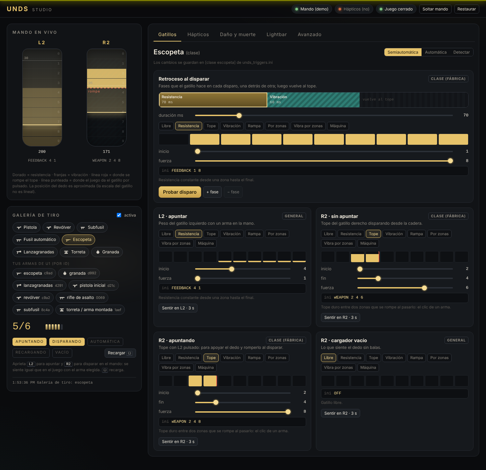

# Uncharted PC DualSense

**DualSense adaptive triggers, haptics and light bar for *Uncharted: The Nathan Drake Collection* on PC.**

*Leer en español: [README.es.md](README.es.md)*

Uncharted PC DualSense (**UNDS** for short — the name you will see inside the package: `UNDS.exe`,
`UNDS Studio`) adds **adaptive triggers, haptics and a live light bar** to the unofficial native PC port
[uncharted_pc](https://github.com/Supermedo/uncharted_pc) by SuperMedo. The PS4 games have no haptic data
of their own (only the DualShock 4's two rumble motors), so every effect is generated from events UNDS
reads out of the running game.

It has two parts:

- **A small patch set for the port** (`patches/v0.3.9`): the port publishes game events over local UDP
  (rumble, pad, light bar, audio levels and, in Uncharted 1, the game state: health, weapon, ammo, shots and
  damage with its direction) and writes trigger/light-bar commands to the controller through SDL. Without
  the `UNDS_EVENTS` variable the port behaves exactly as upstream.
- **The companion** (`UNDS.exe`, Python source in `companion/`): turns those events into trigger effects,
  light bar colours and haptics (WASAPI audio to the DualSense's voice-coil actuators). The port starts
  it with the game, however you start the game.

## What you get

| | Uncharted 1 (game versions 1.00 and 1.02) | Uncharted 2 / 3 |
|---|---|---|
| Adaptive triggers | per weapon class: pistol, revolver, SMG, automatic rifle, shotgun, grenade launcher, grenades, mounted turret (jeep, jet-ski); recoil kick per shot, empty clip, aim weight, calm/combat, menus and cutscenes | generic profile from the rumble signature of each shot |
| Haptics | game rumble re-synthesised for the actuators, a voice per shot (per weapon class), directional hits (left/right, front/back), death | game rumble + shot detection from rumble |
| Light bar | game colour, health tint, damage flashes, death fade | game colour, damage estimate |

The game-state hooks are matched by instruction pattern at start-up. All four match exactly once in the
U1 executables of game versions 1.00 and 1.02 (1.00 played, 1.02 checked with `tools/check_unds_hooks.py`);
if your executable differs they simply stay off and UNDS falls back to the generic mode.

## Requirements

- Windows 10/11 x64, the **official uncharted_pc v0.3.9 release** already running your own game dump.
- **DualSense over USB** (haptics are audio and only work over USB; triggers and light bar go through SDL
  and should also work over Bluetooth, not tested).
- **DSX closed** (it turns the haptics off and fights over the triggers) and Steam Input off for the port.
- About 11.5 GB of free memory (RAM + page file), as the port itself needs.

## Install

1. Extract the official `uncharted-windows.zip` (v0.3.9) and check that the game starts.
2. Extract `Uncharted-PC-DualSense-1.0.0-uncharted_pc-0.3.9-windows.zip` **in the folder that contains `uncharted-windows`**
   (not inside it): the zip already has an `uncharted-windows` folder that merges with yours (overwrite
   when asked). It replaces `run.py` and `bin\` (port + UNDS patches;
   your DLSS/XeSS files stay) and adds `UNDS\`.
3. Windows sound settings → Playback → *Speakers (Wireless Controller)* → Configure → **Quadraphonic**, and
   set that device's volume to **100 %** (channels 3–4 are the actuators).
4. In the port's launcher, *Fixes → Mesh raycaster copies* = **Automatic** (with UNDS it is now on in U1
   and U2, where the game can stop with `iSubMesh` after a checkpoint).
5. **Play as usual** (`Uncharted.exe`, the launcher's desktop or Steam shortcut). When the game starts,
   the UNDS companion starts with it in a minimized console window and closes when the game ends
   (`window = hidden` in `unds_launcher.ini`: no window). Its log is `UNDS\logs\unds.log`.

Double-clicking `UNDS\UNDS.exe` also works: it first checks free memory, an old game left open and DSX,
then opens the port's launcher. `auto = no` in `unds_launcher.ini` (or `UNDS_AUTO=0` in the launcher's
*Environment* field) stops the game from starting UNDS by itself.

If the light bar **blinks red** and the PC beeps, the port reported a problem (a bad start-up that may lose
data, a data-loss warning, a game assertion or a crash): the console says which. After a bad start-up,
close the game and start it again before playing on.

## UNDS Studio: tune it visually



`UNDS\UNDS Studio.cmd` (or `UNDS.exe --studio`) opens a local page in your browser to tune everything by
feel, DSX-style, with the game **closed** and the controller on USB:

- **Live triggers**: L2 and R2 drawn with their 10 resistance/vibration zones and your finger's position.
- **Shooting range**: pick a weapon, pull R2 on the controller and feel the shot exactly as in game
  (recoil phases, haptic voice, bursts for automatics, magazine; Square reloads).
- **Visual editors**: trigger effects with sliders, the recoil as a timeline of phases, haptic voices with
  their waveform, a compass to feel directional hits, death, rumble motors, light bar colours, and every
  other parameter in an *Advanced* table.

Every change is validated and saved straight into the `.ini` files (a backup is made when the Studio opens;
*Restore* puts it back), so with the game open the companion picks it up at once — the Studio then only
edits, since the game owns the controller.

## Settings

All in `uncharted-windows\UNDS\`, reloaded on save while playing:

- `unds_triggers.ini` — trigger effects per weapon class and per weapon, light bar, combat timing.
- `unds_haptics.ini` — haptic voices, rumble translation, device.
- `unds_launcher.ini` — start with the game or not, hidden or in a console, recording, checks, and the
  variables passed to the port.

`record = yes` in `unds_launcher.ini` saves a JSONL trace of each session in `UNDS\recordings\` for bug
reports. `UNDS.exe --help` lists the options (`--selftest` checks the bundled libraries and audio devices,
`--check`, `--no-haptics`, `--no-triggers`, `-v`).

## Troubleshooting

- **No haptics**: DSX open, controller on Bluetooth, the device not in Quadraphonic or its volume low, or
  `UNDS_RUMBLE=0` overridden in the launcher's *Environment* field.
- **Triggers do nothing**: the launcher's *Environment* field wins over UNDS's variables; remove any
  `UNDS_EVENTS` from it (when it is set there, the game expects you to run a companion yourself).
  `UNDS.exe --check` verifies that `bin\bb-probe.exe` has UNDS.
- **Antivirus warning on UNDS.exe**: PyInstaller executables are sometimes flagged; you can run the
  companion from source instead (below).
- **The port's launcher offers an update**: updating replaces `bin\` and `run.py`; UNDS needs a release
  built for that version.

## Building from source

In an MSYS2 CLANG64 shell (the port's own build environment, see its `packaging/windows/README.md`) and a
Python 3.12 from python.org:

```sh
bash scripts/unds_build.sh --deps   # clones uncharted_pc v0.3.9, applies patches/v0.3.9, builds and packages
bash scripts/unds_release.sh        # UNDS.exe (PyInstaller) + build/Uncharted-PC-DualSense-<version>-...zip
```

Companion from source (CMD): `pip install -r companion\requirements.txt`, then `python companion\unds_launcher.py`
next to the port, or `python companion\unds.py` with `UNDS_EVENTS=127.0.0.1:47111 UNDS_TRIGGER=30,95
UNDS_RUMBLE=0` in the launcher's *Environment* field. `tools\check_unds_hooks.py` checks the game-state
patterns against an executable.

### The patches

| | |
|---|---|
| 0001 | event bus (UDP) for external controller companions |
| 0002 | `UNDS_LED`, `UNDS_TRIGGER` and physical trigger travel in pad events |
| 0003 | game state for U1 (health, weapon, ammunition, shots, damage) |
| 0004 | control channel: adaptive triggers and light bar through SDL |
| 0005 | red zone: reserve thunk memory before the GPU starts (fixes rare bad start-ups; upstream candidate) |
| 0006 | Windows fault report names the thread and the caller, writes `user\crash.dmp` (upstream candidate) |
| 0007 | mesh raycaster copies on by default in U1 too (upstream candidate) |
| 0008 | `run.py` starts `UNDS\UNDS.exe` with the game when it is installed |

The protocol is documented at the top of `src/runtime_unds.c` once 0001–0004 are applied.

## Known limitations

- Game state only for Uncharted 1 (1.00 played, 1.02 patterns verified); U2/U3 use the generic mode and
  were tested less.
- Weapon names in the `.ini` are guesses from their behaviour; the ids are what counts.
- Jet-ski chapter (U1): the player can die from the explosion of their own far-away grenade. It also
  happens with UNDS off; it is a port/game issue being looked into, not UNDS.

## Credits and license

- [uncharted_pc](https://github.com/Supermedo/uncharted_pc) by SuperMedo (GPL-2.0) — the port this builds on.
- Inspired by the RE4R DualSense Enhanced Edition mod; trigger effect syntax as in DSX's v3 modes.
- UNDS by [marks-jhojan](https://github.com/marks-jhojan), GPL-2.0 (see `LICENSE`), like the port.

UNDS is not affiliated with Sony Interactive Entertainment or Naughty Dog and ships no game files: you
need your own copy of the game.
